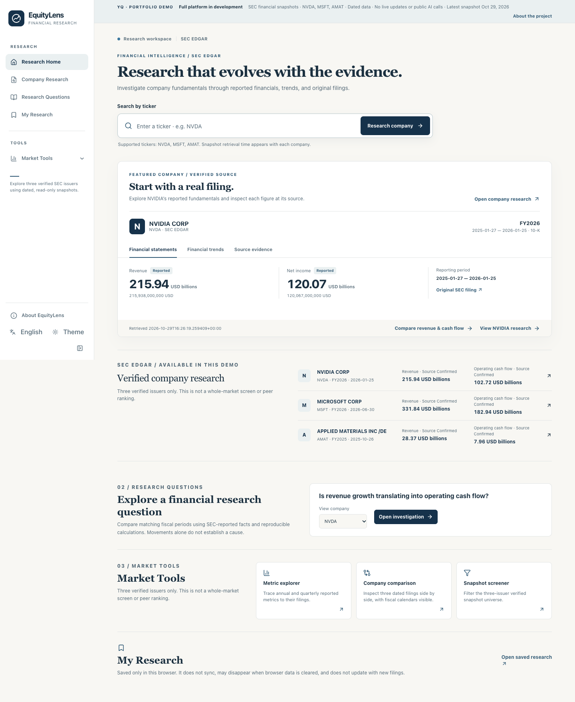
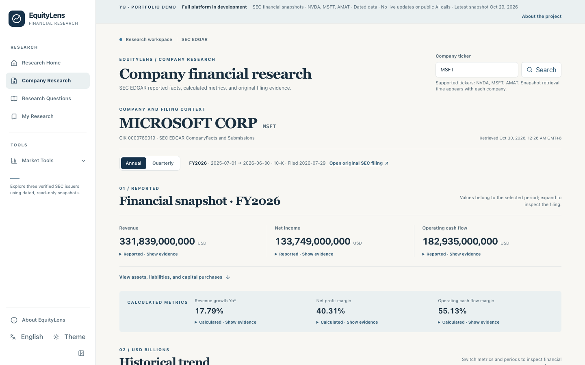
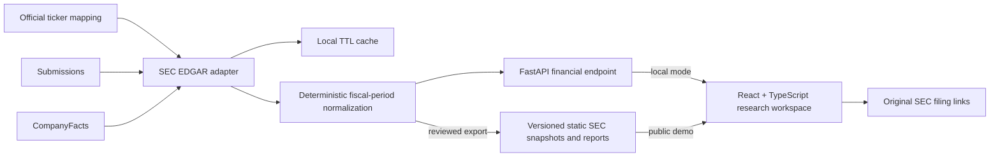

# EquityLens

**Evidence-based company financial research, built on [daily_stock_analysis](https://github.com/ZhuLinsen/daily_stock_analysis).**

EquityLens helps a reader move from a public-company ticker to reported financial statements, historical trends, a focused revenue-versus-operating-cash-flow investigation, and the original SEC filing behind each important number. The [public, read-only portfolio demo](https://equitylens-portfolio-v01.pages.dev/) uses dated SEC snapshots; the full FastAPI application remains local. The deterministic investigation does **not** generate an AI investment conclusion or make trading recommendations.

**Development status:** the public **Portfolio Demo v0.2.1** offers NVDA, MSFT and AMAT snapshots, one structured research question, three-company read-only Market Tools, browser-local saved research, and an About/Methodology page. The local FastAPI application contains additional inherited tools with different readiness. See the [v0.2.1 release record](docs/equitylens/V0_2_1_RELEASE.md) and [bounded validation](docs/equitylens/V0_2_RELEASE_CANDIDATE.md).

The curated release universe is **NVIDIA (NVDA), Microsoft (MSFT), and Applied Materials (AMAT)**. Four recent fiscal periods per issuer were sampled against official SEC data, checking 30 reported facts and six derived-quarter values in total. This does not certify every historical value or all SEC-listed issuers. The financial workflow works without an LLM key or account.

## See the working application

**Live portfolio demo:** [Research Home](https://equitylens-portfolio-v01.pages.dev/) · [NVIDIA research](https://equitylens-portfolio-v01.pages.dev/research/NVDA) · [research question](https://equitylens-portfolio-v01.pages.dev/questions) · [About and methodology](https://equitylens-portfolio-v01.pages.dev/about). The fixed SEC snapshots were retrieved on **2026-10-29 UTC**. The site does not provide live updates or inherited backend tools. [Deployment and rollback details](docs/equitylens/V0_2_1_RELEASE.md).

The [GitHub feature branch](https://github.com/yqiu6250uu/daily_stock_analysis/tree/feature/equitylens-foundation) contains the source and release documentation corresponding to the public v0.2.1 build. The repository default `main` remains the inherited upstream baseline.

The screenshots below were captured from the **actual public v0.2.1 HTTPS site** after deployment, using its dated SEC snapshot files. They are neither static design prototypes nor synthetic test fixtures.

| Research Home | Company Research |
| --- | --- |
| [](docs/equitylens/images/v021-home-en-light.png) | [](docs/equitylens/images/v021-company-msft-en.png) |

[Full research question report](docs/equitylens/images/v021-report-nvda-en.png) · [Expanded SEC evidence](docs/equitylens/images/v021-evidence-nvda-en.png) · [Research Home in Chinese and dark mode](docs/equitylens/images/v021-home-zh-dark.png) · [Mobile Chinese company page](docs/equitylens/images/v021-company-amat-zh-mobile.png) · [About and methodology](docs/equitylens/images/v021-about-en.png)

## What works today

- **Research Home:** ticker-only search restricted to the three checked issuers in the static build, three period-labeled company entries, a featured NVDA filing preview, a direct question entry, Market Tools and My Research access, bilingual controls and light/dark themes.
- **Company Research:** annual and quarterly SEC-derived facts, fiscal context, revenue/net-income/operating-cash-flow trends, calculated ratios, missing-data indicators, and original filing links. Values distinguish **reported** facts from **derived** figures.
- **Focused investigation:** “Is revenue growth translating into operating cash flow?” opens a deterministic report with like-period facts, eight Decimal calculations, observations, alternative explanations needing review and original SEC evidence. Incompatible or missing periods remain explicit. This is **not** an AI answer or a causal finding.
- **Limited public tools:** metric explorer, three-company comparison and screener over exactly NVDA/MSFT/AMAT; saved research stays in the current browser and can be reopened, removed and exported as Markdown context.
- **About and Methodology:** explains source provenance, bounded verification, technology, limitations, AI-assisted development and upstream attribution.
- **Legacy Market Tools (local application only):** the original project's analysis, market review, screening, backtesting, alerts, and related tools retain their local routes. They require separate configuration/data sources and are not publicly exposed as working static features; see [feature status](docs/equitylens/FEATURE_STATUS.md).

### Architecture



The adapter requires a valid `SEC_CONTACT_EMAIL` before making SEC requests. It uses bounded retries, timeouts, conservative process-level pacing, and a local cache. Normalization keeps period dates, form, accession, concept, unit, filing and retrieval dates, and source URLs. Same-context conflicts and incompatible/missing data are surfaced rather than filled with estimates. Calculated values retain their definitions and input sources. The local cache is not a cross-instance rate limiter or a public backend architecture; the public demo serves a precomputed static JSON snapshot instead.

## Run locally

Tested with **Python 3.12**, **Node.js 24** and **npm 10**. The Web package declares Node `>=20.19 <27` and npm `>=10`. Use a compatible stable Python version and a local-only server.

```bash
python3.12 -m venv .venv
.venv/bin/python -m pip install -r requirements.txt
cd apps/dsa-web
npm ci
npm run build
cd ../..
cp .env.example .env
```

Set `SEC_CONTACT_EMAIL` in your local `.env` to a real project contact address. **Do not commit that file.** No LLM API key is needed for Research Home or Company Research. Then start the already built app, bound to the loopback interface:

```bash
STOCK_INDEX_REMOTE_UPDATE_ENABLED=false SCHEDULE_ENABLED=false \
  .venv/bin/python -m uvicorn server:app --host 127.0.0.1 --port 8000 --no-proxy-headers
```

Open `http://127.0.0.1:8000/` and then `/research/NVDA`. The first uncached SEC request needs internet access and a valid SEC contact identity. The `.env`, `data/` SEC cache, logs, and build output are Git-ignored. **Do not expose this development server publicly:** the inherited backend has additional routes and local authentication may be disabled.

### Checks

```bash
.venv/bin/python -m pytest -q tests/test_sec_financials.py tests/test_api_health.py
cd apps/dsa-web
npm run build
./node_modules/.bin/vitest run --maxWorkers=2
./node_modules/.bin/playwright test --config playwright.fixture.config.ts --workers=1
```

Playwright fixtures use **synthetic intercepted API data** to test interactions; they do not establish SEC accuracy. [Recorded test evidence](docs/equitylens/TEST_RESULTS.md), [known limitations](docs/equitylens/KNOWN_LIMITATIONS.md), and the [case study](docs/equitylens/PORTFOLIO_CASE_STUDY.md) explain the verification scope.

## Development status and attribution

EquityLens extends the MIT-licensed [ZhuLinsen/daily_stock_analysis](https://github.com/ZhuLinsen/daily_stock_analysis) project. The original Python/FastAPI/React application, legacy analysis routes, data providers, reporting, and notification features are inherited. The SEC adapter, financial normalization/API, evidence-centered research views, focused comparison, branding, and related tests/documentation are EquityLens additions or substantial adaptations. The original copyright and MIT [LICENSE](LICENSE) are retained. The [upstream documentation](docs/README_EN.md) describes inherited DSA capabilities and may not describe EquityLens's current behavior.

**Next:** pursue [US-first universal coverage and A-share source feasibility](docs/equitylens/UNIVERSAL_COMPANY_COVERAGE_ROADMAP.md) as a separately verified initiative. Live AI explanations, automatic Follow updates, a public backend and broad issuer coverage remain unavailable. The public site does not expose FastAPI or use paid infrastructure. See [feature status](docs/equitylens/FEATURE_STATUS.md), [deployment notes](docs/equitylens/V0_2_1_RELEASE.md), and [release checklist](docs/equitylens/RELEASE_CHECKLIST.md).
