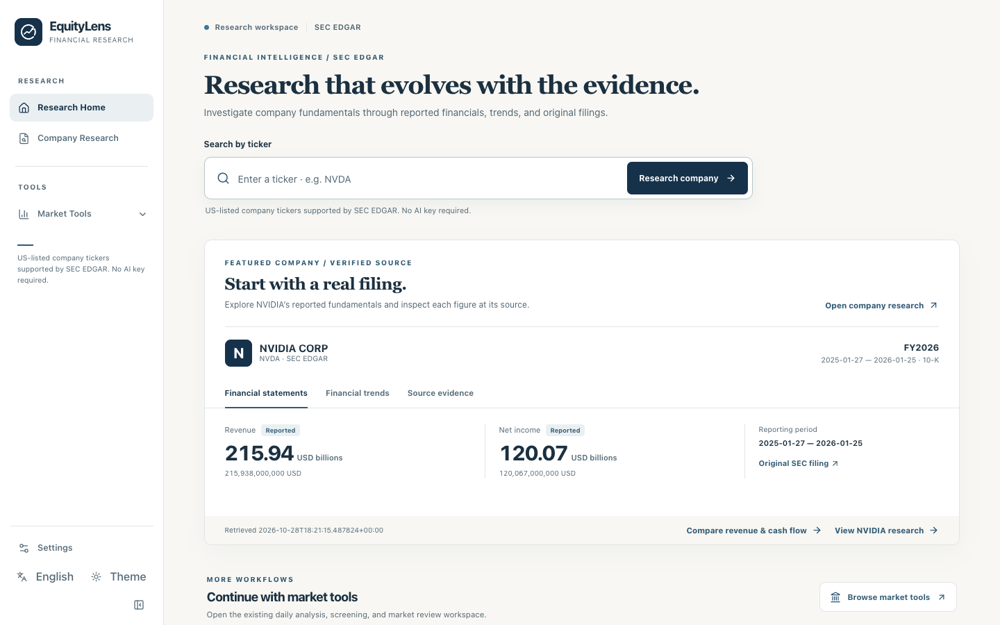
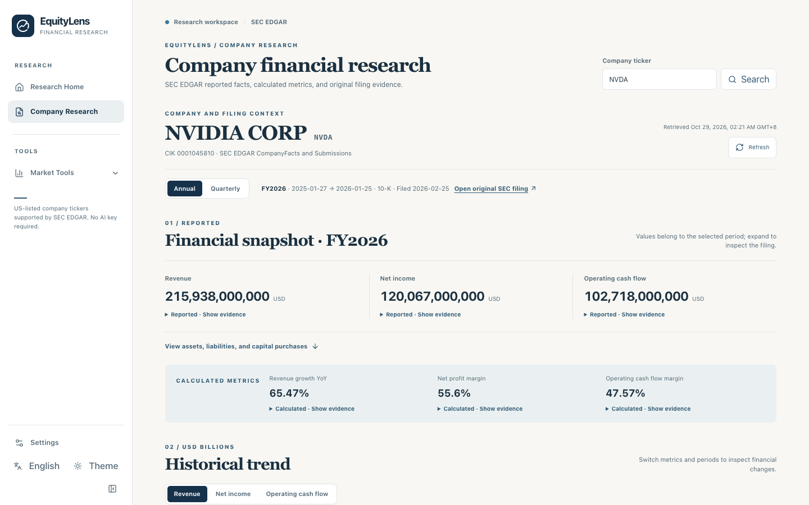
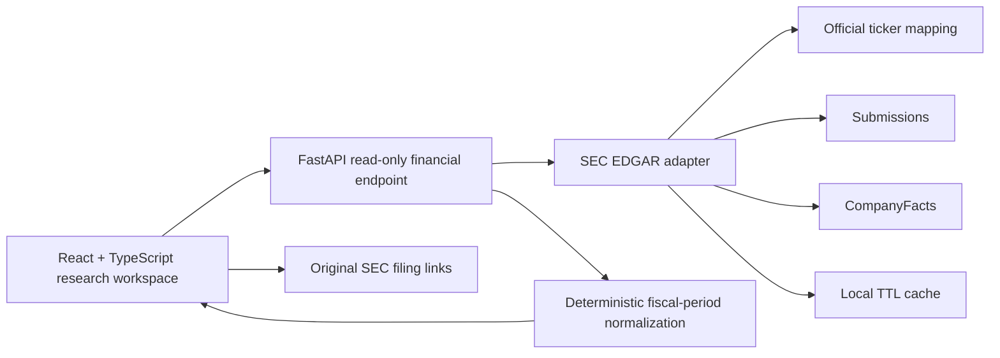

# EquityLens

**Evidence-based company financial research, built on [daily_stock_analysis](https://github.com/ZhuLinsen/daily_stock_analysis).**

EquityLens helps a reader move from a public-company ticker to reported financial statements, historical trends, a focused revenue-versus-cash-flow comparison, and the original SEC filing behind each important number. A [public, read-only portfolio demo](https://equitylens-portfolio-v01.pages.dev/) now shows the verified NVIDIA workflow with a dated SEC snapshot; the full FastAPI application remains local. It uses deterministic calculations and source-linked disclosures; it does **not** generate an AI investment conclusion or make trading recommendations.

**Development status:** the live website is the stable **v0.1 NVIDIA-only** demo. A local **v0.2 release candidate** adds verified MSFT and AMAT snapshots, a structured revenue/cash-flow investigation, a three-company read-only tools workspace, and browser-local saved research. These additions are **not yet deployed**. See the [v0.2 release candidate](docs/equitylens/V0_2_RELEASE_CANDIDATE.md) for precise scope and verification.

The live verified example is **NVIDIA (NVDA)**. The local v0.2 candidate also includes bounded, issuer-specific verification for **Microsoft (MSFT)** and **Applied Materials (AMAT)**; that sample does not certify every historical value or all SEC-listed issuers. The SEC workflow works without an LLM key or account.

## See the working application

**Live portfolio demo:** [equitylens-portfolio-v01.pages.dev](https://equitylens-portfolio-v01.pages.dev/) · [NVIDIA research](https://equitylens-portfolio-v01.pages.dev/research/NVDA). The public site supports **NVDA only**, uses the SEC response retrieved on **2026-10-29**, and does not provide live financial updates or the inherited backend tools. [Deployment and snapshot details](docs/equitylens/PORTFOLIO_DEMO_DEPLOYMENT.md).

These screenshots were captured from the actual locally running React/FastAPI application on **2026-10-29**. They show SEC-backed NVDA data, not a design prototype or synthetic browser fixture. The displayed retrieval time belongs to the cached SEC response.

| Research Home | Company Research |
| --- | --- |
| [](docs/equitylens/images/research-home-en.png) | [](docs/equitylens/images/company-research-en.png) |

[Revenue and operating cash flow comparison](docs/equitylens/images/revenue-cash-flow-en.png) · [Expanded SEC source evidence](docs/equitylens/images/sec-source-evidence-en.png) · [Research Home in Simplified Chinese](docs/equitylens/images/research-home-zh.png) · [Company Research in Simplified Chinese](docs/equitylens/images/company-research-zh.png) · [Mobile company view](docs/equitylens/images/company-research-mobile-en.png)

## What works today

- **Research Home:** ticker-only search with validation, a featured NVDA filing preview, reported figures, an annual revenue chart, source links, English/简体中文 controls, and light/dark themes.
- **Company Research:** annual and quarterly SEC-derived facts, fiscal context, revenue/net-income/operating-cash-flow trends, calculated ratios, missing-data indicators, and original filing links. Values distinguish **reported** facts from **derived** figures.
- **Focused investigation:** “Is revenue growth translating into cash flow?” opens a deterministic, like-period revenue and operating cash flow comparison. It explains incompatible or missing periods and exposes the underlying XBRL concepts and filings. This is a **fact comparison**, not an AI answer or a causal finding.
- **Legacy Market Tools:** the original project's analysis, market review, screening, backtesting, alerts, and related tools remain accessible in a secondary workspace. Their configuration, data sources, and language coverage differ from the SEC workflow; see [feature status](docs/equitylens/FEATURE_STATUS.md).

### Architecture



The adapter requires a valid `SEC_CONTACT_EMAIL` before making SEC requests. It uses bounded retries, timeouts, conservative process-level pacing, and a local cache. Normalization keeps period dates, form, accession, concept, unit, filing and retrieval dates, and source URLs. Same-context conflicts and incompatible/missing data are surfaced rather than filled with estimates. Calculated values retain their definitions and input sources. The local cache is not a cross-instance rate limiter or a public backend architecture; the public demo serves a precomputed static JSON snapshot instead.

## Run locally

Tested with **Python 3.12**, **Node.js 24** and **npm 10**. The Web package declares Node `>=20.19 <27` and npm `>=10`. Use a compatible stable Python version and a local-only server.

```bash
python3.12 -m venv .venv
.venv/bin/python -m pip install -r requirements.txt
cd apps/dsa-web
npm ci
npm run build
cd ../..
cp .env.example .env
```

Set `SEC_CONTACT_EMAIL` in your local `.env` to a real project contact address. **Do not commit that file.** No LLM API key is needed for Research Home or Company Research. Then start the already built app, bound to the loopback interface:

```bash
STOCK_INDEX_REMOTE_UPDATE_ENABLED=false SCHEDULE_ENABLED=false \
  .venv/bin/python -m uvicorn server:app --host 127.0.0.1 --port 8000 --no-proxy-headers
```

Open `http://127.0.0.1:8000/` and then `/research/NVDA`. The first uncached SEC request needs internet access and a valid SEC contact identity. The `.env`, `data/` SEC cache, logs, and build output are Git-ignored. **Do not expose this development server publicly:** the inherited backend has additional routes and local authentication may be disabled.

### Checks

```bash
.venv/bin/python -m pytest -q tests/test_sec_financials.py tests/test_api_health.py
cd apps/dsa-web
npm run build
./node_modules/.bin/vitest run --maxWorkers=2
./node_modules/.bin/playwright test --config playwright.fixture.config.ts --workers=1
```

Playwright fixtures use **synthetic intercepted API data** to test interactions; they do not establish SEC accuracy. [Recorded test evidence](docs/equitylens/TEST_RESULTS.md), [known limitations](docs/equitylens/KNOWN_LIMITATIONS.md), and the [case study](docs/equitylens/PORTFOLIO_CASE_STUDY.md) explain the verification scope.

## Development status and attribution

EquityLens extends the MIT-licensed [ZhuLinsen/daily_stock_analysis](https://github.com/ZhuLinsen/daily_stock_analysis) project. The original Python/FastAPI/React application, legacy analysis routes, data providers, reporting, and notification features are inherited. The SEC adapter, financial normalization/API, evidence-centered research views, focused comparison, branding, and related tests/documentation are EquityLens additions or substantial adaptations. The original copyright and MIT [LICENSE](LICENSE) are retained. The [upstream documentation](docs/README_EN.md) describes inherited DSA capabilities and may not describe EquityLens's current behavior.

**Next on the public site:** the v0.2 candidate awaits release approval; live AI explanations, automatic Follow updates, a public backend and broad issuer coverage remain unavailable. The public site is static and does not expose the FastAPI service or use paid infrastructure. See [feature status](docs/equitylens/FEATURE_STATUS.md), [deployment notes](docs/equitylens/PORTFOLIO_DEMO_DEPLOYMENT.md), and [release checklist](docs/equitylens/RELEASE_CHECKLIST.md).
