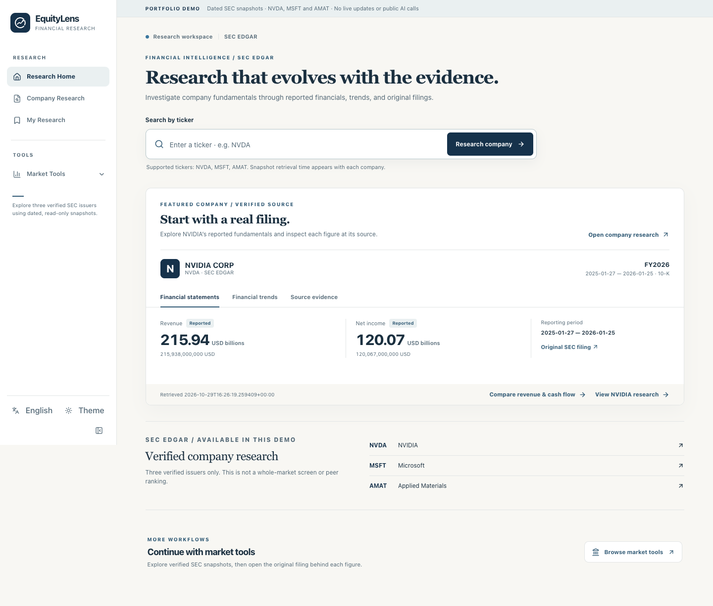
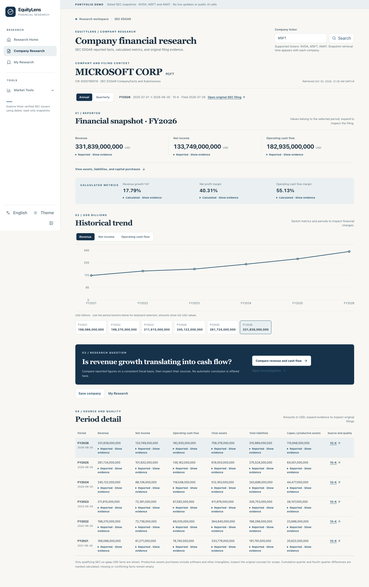
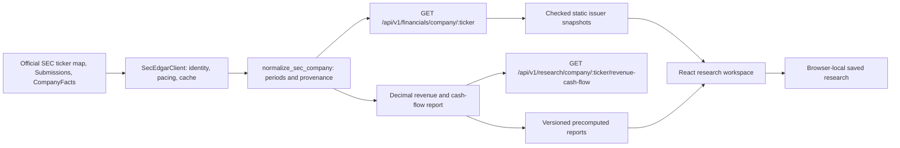

# EquityLens v0.2 — research workspace release candidate

Status: **locally verified release candidate awaiting publication approval**. The public `https://equitylens-portfolio-v01.pages.dev/` remains the original NVDA-only v0.1 production deployment until separate production approval. This document describes the local source and static preview build; it does not claim that v0.2 is publicly live.

## Implemented scope and journey

Research Home → one of **NVDA, MSFT, AMAT** → Company Research → **Is revenue growth translating into operating cash flow?** → reported facts and calculations → original SEC evidence → optional browser-local Save. The static build offers read-only metric exploration, a dated three-company comparison and a filter over **only those three issuers**. It does not query SEC, FastAPI, a database or an LLM in visitors' browsers. Existing legacy tools remain local-only.

The page preserves the warm-white/deep-navy shell, bilingual controls and light/dark themes. Its report distinguishes source-confirmed reported values, calculated quarterly facts, deterministic calculations, observations, possible explanations needing investigation, and insufficient evidence. The text never treats synchronized changes as proof of causation.

## Actual local-build screenshots

These were captured from the **built v0.2 React static candidate** on 2026-10-30, using genuine checked SEC snapshots. They are neither detached HTML prototypes nor screenshots of the still-live v0.1 Cloudflare site.

| Research Home | MSFT Company Research |
| --- | --- |
|  |  |

[MSFT evidence-linked question report](images/v02-report-msft-en-local.png) · [three-company tool workspace](images/v02-tools-en-local.png) · [AMAT report on Chinese dark mobile](images/v02-report-amat-zh-dark-mobile-local.png).

## Data flow and contracts

The new report contract is `RevenueCashFlowReport` **schema version 1** in `api/v1/schemas/research_questions.py` and `apps/dsa-web/src/types/researchQuestions.ts`. The dynamic GET accepts `basis=annual|quarterly` and optional `period_end`; it requires no LLM key. It contains selected current/prior periods, six source-linked facts, eight calculations with input IDs/formula/reason, observation template IDs, quality issues, timestamps, method version and a fact hash. The static build serves the same contract from `/demo/v02/{ticker}-reports.json`. A future schema change must increment its version and validate old saved context.

Annual comparisons use the previous fiscal year and similar duration; independent quarterly values use the **same fiscal quarter** in the previous year. SEC YTD or Q4 differences come only from the pre-existing normalizer and retain input sources. The new report computes absolute revenue, operating cash flow and net-income changes, their percentage growth only with a positive base, and both periods' operating cash flow margin. It uses Python `Decimal` and serializes calculated values as decimal strings. Matching currency/concept is required for a cross-period comparison. If the base is zero/negative, the absolute change remains visible while the growth percentage is null with `nonpositive_base`. Missing or incompatible values remain null. The report does not calculate unqualified free cash flow or equate broad productive-assets purchases with pure PP&E.

The optional **local-only** POST `/api/v1/research/company/:ticker/revenue-cash-flow/interpretation` defaults off behind `EQUITYLENS_AI_INTERPRETATION_ENABLED=false`. When explicitly enabled with a configured private LiteLLM model, it sends a bounded verified fact packet on a user click, validates structured output and citation IDs, rejects numeric claims and obvious causal/investment commands, and caches by fact hash/locale/model/prompt version in bounded process memory. Provider failures never remove the deterministic report. No real-model quality evaluation or paid usage was performed; public AI generation is disabled.

## Issuer release validation

The official SEC ticker map confirms CIKs **1045810 (NVDA), 789019 (MSFT), 6951 (AMAT)**. The v0.2 export independently matched the latest **two annual and two quarterly periods** per issuer against cached official CompanyFacts entries using concept, unit, accession, form, start/end and exact value. This checked 30 reported facts and 6 derived-quarter values across the three issuers. For MSFT and AMAT, the latest 10-K and 10-Q original filing documents were separately retrieved with the configured identified SEC User-Agent and returned HTTP 200. The validation is a bounded sample, not an accuracy claim over every CompanyFacts value, every issuer or future filing. AMD was considered but excluded because its newest amended annual anchor did not expose a reliable fiscal-year label in the current normalizer.

| Issuer | Latest annual period | Revenue (USD) | Operating cash flow (USD) | Annual fiscal end |
| --- | --- | ---: | ---: | --- |
| NVIDIA / NVDA | 2025-01-27–2026-01-25 | 215,938,000,000 | 102,718,000,000 | January |
| Microsoft / MSFT | 2025-07-01–2026-06-30 | 331,839,000,000 | 182,935,000,000 | June |
| Applied Materials / AMAT | 2024-10-28–2025-10-26 | 28,368,000,000 | 7,958,000,000 | October |

These are different businesses and fiscal calendars. The comparison table shows full periods and source filings without rankings, valuation claims or a claim of direct operating equivalence.

## Market Tools availability by mode

| Tool | Public static | Local app | Classification and reason |
| --- | --- | --- | --- |
| Financial metric explorer | Read-only A | A | SEC snapshot annual/quarterly chart and period table. |
| Three-company comparison | Read-only A | A | Dated reported values; fiscal-end warning. |
| Verified-universe screener | Read-only A | A | Filters only three snapshots; no whole-market claim. |
| My Research | Browser-local A | Browser-local A | Versioned localStorage; not an account or automatic monitor. |
| Daily Stock Analysis and Market Review | Unavailable C | Inherited tool | Requires analysis backend, market data and optional LLM/configuration. |
| Inherited Screening and Backtesting | Unavailable C | Inherited tool | Requires legacy strategies, jobs and backend services. |
| Portfolio | Unavailable C | Inherited tool | Can involve private account/manual holdings and local database. |
| Alerts | Unavailable C | Inherited tool | Requires scheduler, notification state and backend. |
| AI Signals and Ask | Unavailable C | Inherited tool | Requires model/provider configuration and backend. |
| Data Center | Unavailable C | Inherited tool | Backend data capability and diagnostic APIs. |

Here **A** means usable with the shipped local/static data; **C** means authenticated/private backend or external service is needed. This is an availability assessment, not an assertion that every inherited local feature has been independently validated to release quality. The public tool index labels local-only capabilities without routing visitors to broken controls.

## Rebuild, validation and deployment boundary

1. Keep `.env` ignored. With a valid SEC contact configured locally, use the existing API to acquire each issuer; review official filing dates and values. `scripts/export_equitylens_v02.py` checks the official ticker map, four selected periods per issuer, reported facts, derived-quarter inputs and source URLs. It writes `apps/dsa-web/public-demo/demo/v02/` and a SHA-256 manifest for both issuer snapshots and report files. `--input-dir` rebuilds from previously captured `NVDA.json`, `MSFT.json` and `AMAT.json` API responses without contacting SEC. Snapshot bytes and fact hashes reproduce; `calculated_at` and report-file hashes reflect the time of each export.
2. Run TypeScript, Python, Vitest, Playwright and security checks listed in `TEST_RESULTS.md`. From `apps/dsa-web`, build using `npm run build:demo`; the upload directory is the **repository-root `demo-dist/`**. It contains static assets only. Validate every snapshot SHA and inspect the whole asset set for secrets, personal paths and `/api/` or localhost calls.
3. The existing Cloudflare Pages project is **Direct Upload**, not Git Integration. For a separately authorized preview, the documented Wrangler syntax is `wrangler pages deploy demo-dist --project-name equitylens-portfolio-v01 --branch v02-preview`; the CLI may require account authentication. Preview does not replace the stable production URL. The final production upload requires separate approval and live HTTPS/browser/snapshot checks, followed by a rollback to the previous deployment if validation fails.

The static build does not use Pages Functions, a public FastAPI service, private API keys, scheduled workflows or paid data. Its intended incremental cost is $0/month within Cloudflare Pages Free limits. Browser-local saves are device-specific and are lost if browser data is cleared; they do not auto-refresh with newer filings. The public v0.1 URL and GitHub default branch remain unchanged at this checkpoint.

## Prioritized roadmap after this approval gate

1. **v0.2 release review:** inspect the local build, five candidate screenshots, financial validation sample, full regression results and static asset scan. After separate approval, publish a Cloudflare preview if authenticated, verify it from the public HTTPS address, then explicitly approve the production replacement. Keep the previous Direct Upload deployment available for rollback.
2. **Research quality:** extend issuer-by-issuer fiscal taxonomy checks and material restatement cases; validate more historical periods. Add a release rule for snapshot age and source consistency before expanding the curated universe.
3. **Optional AI:** only after real-model quality evaluation, private credential handling, authentication, rate limits and a hard spending cap. Public generation is out of scope; no AI interpretation is shipped in v0.2 static assets.
4. **Continuity:** consider opt-in sync/Follow only after a privacy, cost and security design. Current local saves remain device-specific and do not monitor filings.

No whole-market screening, live quote service, autonomous investment advice, broker integration, automatic trading or $5+/month infrastructure is authorized by this milestone.
